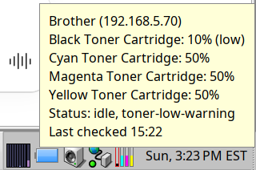
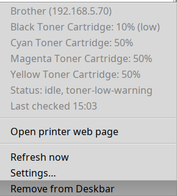
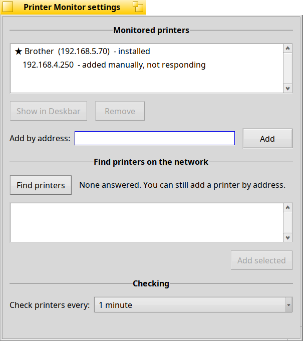

# Printer Monitor for Haiku

Toner levels and printer status in the Haiku Deskbar, with a notification
when a cartridge runs low or empty.

Printer Monitor picks up the printers you have set up in **Printers**
preferences automatically, can find printers on the network, and works with
most network printers that speak IPP (the standard behind AirPrint and IPP
Everywhere). It was developed and tested with a Brother HL-3170CDW.

<p>

&nbsp;

</p>

## Features

- **Tray icon** with one bar per toner cartridge, in its own color. A red
  outline marks a cartridge that is low or empty.
- **Tooltip and menu** with exact levels, printer state, and when it was last
  checked. Open the printer's own web page from the menu.
- **Notifications** when a cartridge becomes low or empty, or a printer stops.
  Once per new condition, not repeatedly.
- **Several printers.** The tray shows your chosen printer; a red line along
  the bottom of the icon means another printer needs attention.
- **Settings window:** add a printer by address, find printers on the network,
  choose the printer shown in the Deskbar, and how often to check (1 to 60
  minutes).
- **Starts with Haiku.** The Deskbar restores the icon at login, and the icon
  starts the monitor. Removing the icon from the Deskbar turns it off.
- **Light and safe.** All network work runs in a separate background app, so a
  slow or missing printer can never freeze the Deskbar.



## Requirements

- Haiku x86_64. Developed and tested on R1/beta6 nightly (hrev60314); other
  recent versions should work but haven't been tested yet.
- A network printer that supports IPP (most modern network printers do).
  Printers connected only by USB are listed, but their status is not
  available yet.

## Installing

**From a release:** download the `.hpkg` file from the
[Releases](https://github.com/DrJuice/haiku-printer-monitor/releases) page and
copy it into `~/config/packages/`. Then choose **Printer Monitor** from the
Deskbar's Applications menu. To uninstall, remove the tray icon (click it,
then *Remove from Deskbar*) and delete the file from `~/config/packages/`.

**From HaikuDepot:** coming soon.

## Using it

- Printers set up in **Preferences > Printers** with a network connection
  (IPP, HP JetDirect or LPR) are monitored automatically. For IPP printers,
  print one page first: Haiku stores the printer's address at the first print.
- Hover over the tray icon for levels; click it for details, *Refresh now*,
  and *Settings...*.
- Other printers can be added by address in the settings window, or found with
  *Find printers* (nothing is added without your choice).

Command line (optional; the settings window does the same):

```
PrinterMonitor --add-printer <address> [resource]   # e.g. 192.168.1.20
PrinterMonitor --remove-printer <address>
PrinterMonitor --default <address>
PrinterMonitor --list
PrinterMonitor --settings
PrinterMonitor --remove        # remove the tray icon and quit
```

## Building from source

Needs the `haiku_devel` package (GCC, `rc`, `xres` and `mimeset` come with
Haiku's development tools).

```
git clone https://github.com/DrJuice/haiku-printer-monitor.git
cd haiku-printer-monitor
make            # the app and the two test tools, in build/
make package    # build/printer_monitor-<version>-<arch>.hpkg
make install    # package + install into ~/config/packages
```

Remove the tray icon before `make install`, so the running app isn't replaced
underneath itself.

Two small command-line tools are built as well, for checking a printer by hand:

```
build/ipp_probe 192.168.1.20          # state and supply levels over IPP
build/mdns_probe -m                   # listen for printers announcing themselves
build/mdns_probe -a 192.168.1.20      # ask one printer directly
```

## Known limitations

- Some printers don't answer Haiku's network discovery queries (the
  HL-3170CDW is one of them). Add those by address, or set them up in
  Printers preferences; monitoring itself works normally.
- Addresses must be numbers (192.168.1.20), not host names.
- Toner levels are only as fine as the printer reports. Many printers report
  coarse steps (the HL-3170CDW: 10%, 50%, 100%), and the monitor shows exactly
  that rather than guessing.
- USB printer status is not available yet.

## Roadmap

- Brother extras over SNMP: drum, belt, fuser and paper-feed life.
- Status for USB printers.
- Help with printing setup: fill in a printer's IPP address from discovery.

Details, findings and design decisions are in [docs/](docs/):
[STATUS](docs/STATUS.md), [FINDINGS](docs/FINDINGS.md),
[DECISIONS](docs/DECISIONS.md).

## License

MIT. See [LICENSE](LICENSE).

Developed by Tony ([DrJuice](https://github.com/DrJuice)), with Claude
(Anthropic). Not affiliated with or endorsed by Brother Industries.

---

<sub>README revision history: 0.1, 2026-11-01, Tony/Claude: initial
creation (milestone 6b).</sub>
